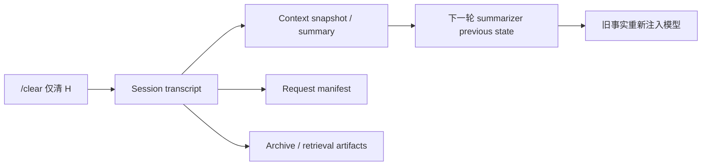

# MimiAgent 全量真实性使用审计与架构根因报告（2026-09-04）

## 0. 审计结论

MimiAgent 已经不是“功能不够多”的阶段。它有较完整的 CLI、Daemon、Session、Memory、Skills、MCP、SubAgent、Team、Connector、持久任务和安全策略，最终稳定快照也通过了 981 项单元测试。就 Mimi 本轮内部证据而言，当前最影响成熟 Agent 体验的因素，是**运行语义在多个边界上没有收敛成同一份可信合同**：工具失败有时是异常、有时是普通文本；上下文压缩存在两套状态；嵌套 Agent 绕开共享运行合同；标识符和用户内容共用清洗器；Daemon 的外部提交、确认和重试各有不同语义；能力策略停留在“工具名”而不是“动作效果”。本轮没有对 Codex、Claude Code、OpenClaw 做同任务对照，因此不把这个判断表述为竞品量化结论。

这会把一个底层缺口放大成用户能直接感知的多种症状：莫名报错、同一工具反复调用、明明失败却被记为成功、简单任务等待几十秒、上下文清理后旧隐私复现、后台任务无法取消、队列被一条坏数据永久阻塞、全新安装未经显式开启就补跑主动例程，以及 CLI/Daemon 对相同配置给出不同判断。

本轮在去除明显重复症状后登记 **53 项独立发现**：

| 等级 | 数量 | 含义 |
| --- | ---: | --- |
| P0 | 3 | 触及核心信任边界，可能产生不可安全自动恢复的跨边界错误，例如副作用假成功、清除后隐私复现或 Provider 丢失工具结果后重复执行 |
| P1 | 29 | 核心工作流不可靠、不可取消、可能范围受限地丢数据/重复执行，或产生显著延迟与成本 |
| P2 | 20 | 明显影响可用性、诊断、规模或结果质量，但有可行绕行方式 |
| P3 | 1 | 低风险的输出噪音 |

其中最需要先处理的不是“再调 Prompt”，而是三项 P0 合同缺陷：

1. 原生 Anthropic/Gemini 适配器不能编码 Agents SDK 的真实工具结果对象，下一轮模型收到空结果并可能重复执行工具。
2. SDK 默认错误捕获发生在执行账本边界内侧，工具抛错会被转成普通文本并被账本永久记录为 `succeeded`。
3. `/clear` 只清 Session 消息，不清上下文工作快照；旧隐私可被摘要器重新写回并再次注入模型。

因此，建议把后续工作定位为一次**运行内核与边界合同收敛**，而不是逐个修补 UI 文案或给模型增加重试提示。

## 1. 基线、范围与真实性边界

### 1.1 最终基线

- 最终复核提交：`c8cd9f8e988a20465985fac284bb8fac7db8b679`，`fix(runtime): preserve reasoning across tool continuations`。
- 最终复核前，工作树仅有用户已有的 `knowledge/wiki/_log.md` 修改；本报告是审计新增的唯一仓库文件。
- 审计过程中用户同时修改并提交过 Provider 相关文件。早期一次 `provider-contract` 失败发生在文件正在变化的窗口内，最终稳定快照已通过，因此不把它列为产品缺陷。
- 除 3.4 节暴露的 launchd 全局 plist 例外外，所有真实运行都使用隔离目录 `/tmp/mimi-ux-audit.3t6inN`；只读复用了本机 Provider 配置和 `.env`，未把测试会话写入用户的正常 Mimi 数据目录。该全局例外已在审计中恢复并复核。

### 1.2 覆盖范围

- 用户路径：无工具问答、文件读取、缺失文件、连续对话、自然语言与显式 Skill、SubAgent、Ultra/Team、模式切换。
- 上下文与状态：Session、compact、clear、summary、Goal、Plan、Checkpoint、Team、ExecutionLedger。
- Memory：检索质量、冷/热启动、并发写、初始化失败恢复、每轮扫描成本。
- 工具与 Provider：真实 Agents SDK Runner、原生 Provider 适配器、Tool 错误、账本、取消、预算、流式输出、文件与 Shell 工具。
- Skills/MCP：发现、激活、资源边界、分页、模板、结果大小、部分失败、读写效果和缓存语义。
- Daemon：SQLite Event/Task/Schedule/Outbox、IPC、Connector ACK、租约、取消、健康度、Attention/例程、macOS LaunchAgent。
- 静态架构：通过 codebase-memory 知识图谱定位调用链和复杂度热点，再回到精确源码与动态故障注入验证。
- 工程门禁：类型检查、全量单测、聚焦回归、检索/记忆/安全/M1 评测、容量基准、包烟测和仓库一致性检查。

### 1.3 没有覆盖或有意禁止的动作

- 未用真实个人账号发送邮件、IM、日历、支付、交易或修改远端业务数据。
- 未使用真实 Anthropic/Google API Key 做计费 canary；这两类 Provider 用 localhost fake server，但 Runner、Tool 和适配器均为生产代码。
- 未做 GUI 可用性、24 小时 soak、多机/多用户并发、网络断续一整天和真实 Connector 端到端发送。
- 未在同一硬件和同一任务上运行 Codex/Claude Code/OpenClaw，所以本报告不伪造产品间量化排名；“差距”来自 Mimi 自身可复现的时延、重复调用和可靠性行为。
- `npm run build` 和 `npm run ci` 未执行：工作树存在用户修改，而 build 会清理 `dist/`。已执行严格类型检查、全量 TypeScript 测试和 packed-package smoke test。
- 一次用于 mock `web_search` 的注入没有拦截 `undici.fetch`，意外产生了一次无凭据、只读的 Bing 请求；其返回不作为任何发现的证据。
- 动态故障注入证据本轮保存在临时 harness/目录，而不是仓库 fixture：审计时包括 `/tmp/mimi-context-memory-audit.mts`、`/tmp/mimi-context-memory-extra-audit.mts`、`/tmp/mimi-cua-debug.mts` 和 `/tmp/mimi-ux-audit.3t6inN` 下的 trace/DB；其余一部分为 inline harness + OS 临时目录。这些临时证据可能被系统清理，修复时必须把每项转成仓库内 regression。条件读取过度执行和完整 Trace 偏重是一次性定性观察，不单独计入 53 项根因清单。

“全量”在本报告中表示跨主要子系统的广覆盖与深故障注入，不表示对所有外部账号、所有模型和所有时序组合做数学穷举。

## 2. 真实用户旅程结果

真实对话走的是当前配置的 **Friday gateway / `deepseek-v4-pro` 路由**，不是原生 DeepSeek 直连。下表时间均为进程外墙钟时间。

| 场景 | 墙钟时间 | 工具/Token | 结果与问题 |
| --- | ---: | --- | --- |
| 4 次固定无工具回复 | 3.46、5.03、5.41、6.64 秒；p50 5.22 秒 | 0 次工具 | 内容正确；简单请求仍有明显等待 |
| 读取 `package.json` 并回答 3 行 | 7.53 秒 | `read_file` 1 次 | 结果正确；Trace 保存了完整 package 内容，观测数据偏重 |
| 新会话记住两个事实 | 15.92 秒 | 0 次工具 | 正确，但终端显示“7 秒”，漏掉约一半 bootstrap 墙钟时间 |
| 同会话追问事实 | 6.98 秒 | 0 次工具 | 两个事实都正确召回 |
| 读取不存在文件 | 16.70 秒 | `read_file` 1 次 | 最终回答正确；中间暴露泛化的 `An error occurred... ENOENT` |
| “若文件存在才读 README” | 19.86 秒 | 缺失文件和 README 各读 1 次 | 模型并行发出两个读取，违反自然语言条件并过度回答 |
| 自然语言“使用 code-review Skill” | 56.89 秒 | `read_file` 3 次、`inspect_capabilities` 2 次；Skill 未激活 | 直接读取 Skill 文件，且超过用户要求的 120 字；5 次调用没有完成正式激活 |
| 显式 `$code-review` 的等价任务 | 11.11 秒 | `read_file` 1 次；Skill 已激活 | 结果正确；比自然语言路径快 5.1 倍，工具调用少 80% |
| 委托一个 SubAgent 检查 SemVer | 36.64 秒 | 嵌套 2 请求，输入 11,144、输出 235、合计 11,379 tokens | 最终正确；执行前有大段重复自我讨论，任务价值与成本严重不成比例 |
| 切换 Ultra | 8.57 秒 | — | 成功，但控制动作延迟偏高 |
| Team 并行完成两个简单计算 | 29.76 秒 | 两个 worker 合计 9,745 tokens，不含 host | 首次错误选择 builder 且因无 tester 失败，再改成 explorer 重试；最终正确但模板和成本过重 |

这些样本说明：主链路并非不可用，且普通答案、连续会话、文件读取最终结果通常正确；但 Skill 发现、嵌套 Agent、Team、错误恢复和计时的体验仍不稳定。性能问题并非纯粹由模型速度决定：显式和自然语言 Skill 使用同一路由却相差 5.1 倍，说明 Host 侧发现协议和决策回路是显著贡献因素；但两条路径各只有一个样本，不能据此量化各因素占比。

## 3. 干净环境与常驻运行实测

### 3.1 干净 CLI/Daemon

- `--help`、`daemon --help`、`--version` 正常。
- `daemon status --json` 在离线时正确返回 `running:false`。
- 缺少 API Key 时 `daemon doctor` 以退出码 0 返回 `ready:false` 和 issues；适合展示诊断，但不适合作为 CI 健康门禁，调用方必须解析 JSON。
- 显式指定不存在的模型注册表时，`provider list` 退出 1；同一配置下 Daemon 可走 legacy fallback 启动。CLI 与 Daemon 对相同配置源存在分叉语义。

### 3.2 默认主动行为不是 opt-in

全新隔离配置启动后，Daemon 在约 10:17 自动补跑了计划于 08:00 的 morning routine。该事件具有 owner trust、`workspaceAccess:write`，Prompt 允许回复、创建提醒和调整计划。默认 Attention 还启用早晚 briefing、日常 routine，并配置每小时 20 runs / 400k tokens、每天 1000 runs / 2m tokens 的自主预算。

同一干净状态还记录过一次 `attention.budget_exhausted(reason=token_usage_unavailable)`，约 7 分钟后恢复。它没有造成外发，本轮也没有把根因隔离到预算、Provider usage 或恢复逻辑，因此只作为未分类观察记录，不计入 53 项发现。

这不是单纯的“定时器偏差”：当前 `emitDueRoutines` 只判断计划时间是否早于当前时间，没有 misfire grace；加上功能默认开启，首次启动或睡眠恢复就可能执行用户从未明确开启的写能力任务。隔离环境中 Connector 被禁用，没有产生真实外发，但默认授权边界本身不符合本地个人 Agent 的最小惊讶原则。

### 3.3 健康度误报

在 Connector 全部禁用、队列为空、无 dead letter 的干净状态下，仅因为 Computer transport 为 ready 而 operational readiness 为 unknown，整体健康度就被判为 `unhealthy`。这会让用户无法区分“Agent 核心不可用”和“一个可选能力尚未完成探测”。

### 3.4 macOS LaunchAgent 全局配置竞争

隔离 Daemon 测试触发了一个真实的全局副作用：只要用户目录存在全局 plist，`daemonStartupMode` 就选择 launchd；`installMimiLaunchAgent` 随后无条件重写同一个 `~/Library/LaunchAgents/com.mimiagent.daemon.plist`。两个 CLI 在 Daemon 刚退出时并发启动，一个成功，另一个收到原始错误：

```text
launchctl bootstrap failed: 5: Input/output error
```

与此同时，全局 plist 被暂时改成了隔离测试目录。审计已立即 bootout 测试服务，把 plist 精确恢复到原 Mimi 数据目录、workspace、session、Connector、assistant 和日志路径，`plutil -lint` 通过，并确认 label 未加载、无遗留 Daemon 进程。

根因是“是否使用 launchd”“服务配置属于哪个数据根”“谁负责安装/更新全局服务”三个概念合并在一个全局文件中，且没有安装锁或 compare-and-swap。这也是用户所说“莫名其妙报错”的一个真实来源。

## 4. 完整发现清单

证据标记：**实测**表示真实生产路径或故障注入已复现；**源码**表示由实现和合同缺口确认，但本轮未连接真实外部服务。

### 4.1 工具、Provider、SubAgent、Team、Skills 与 MCP（16 项）

| ID | 等级 | 发现、证据与影响 | 根因位置 |
| --- | --- | --- | --- |
| EXE-01 | P0 | **实测**：原生 Anthropic/Gemini 在真实 SDK Runner 的第二轮丢失工具结果。SDK 返回 `{type:'text', text:'...'}`，适配器只处理字符串/数组，Provider 收到空结果；Anthropic mock 连续执行同一工具 4 次后 `MaxTurnsExceeded`。 | `src/runtime/providers/native-model.ts` 的 `contentText` 和两类 tool-result 编码器没有统一 SDK↔Provider codec。 |
| EXE-02 | P0 | **实测**：有副作用工具第一次抛出 `disk full`，SDK 默认 `errorFunction` 把它变成普通文本；ExecutionLedger 将该调用记成 `succeeded`。第二次相同调用不再执行，而是回答“已经成功执行”。 | `src/runtime/tool-ledger.ts` 的账本包在 SDK 捕获边界外；异常/失败/不确定/成功没有结构化 `Outcome`。 |
| EXE-03 | P1 | **实测**：确定性的 workspace path escape 仍返回“请重试”式文本，模型重复同一非法调用 4 次直至 max turns。 | 可重试性编码在自然语言中，没有 `retryable:false`、错误码和 no-progress 检测。 |
| EXE-04 | P1 | **实测**：假 SubAgent 连续生成 200 个空结果后仍继续，第 201 次才由 fixture 自行结束。默认不固定 turn 是项目的有意设计，不是缺陷；缺陷是嵌套运行没有可靠继承父级取消、上下文/用量预算、deadline 和 progress lease，空输出也不构成可观察的无进展。 | 各 Runner 没有共享同一份终止合同；不能用固定重试次数掩盖根因。 |
| EXE-05 | P1 | **实测**：父任务 AbortSignal 没有传入 SubAgent 的嵌套 request，文档承诺的取消对 SubAgent 不成立；Team 路径能传递。 | `src/extensions/subagents.ts` 直接创建 bare Runner，绕开父 Run 的 cancellation contract。 |
| EXE-06 | P1 | **实测**：binding 指定 `maxTurns=2`、`maxOutputTokens=123`，SubAgent 仍请求 5 次且请求中 `maxTokens` 未设置；Team 有同类预算脱节。 | 主 pipeline 只向嵌套层传 `.model`；嵌套 Runner 硬编码或忽略 runtime profile。 |
| POL-01 | P1 | **实测/源码**：Plan 中 `clear`、`new`、`reload`、模型控制等破坏性 control action 仍可达；Safe 下外部 MCP resource 也可达。文档明确允许 Plan 的只读 MCP Resource wrapper，且 `switch_mode` 只影响下一轮，因此这两项不作为越权证据。 | policy 只按工具名/`control` 分类，没有按 read/write/control、local/external、fresh/cached 拆动作效果。 |
| MCP-01 | P1 | **实测**：MCP ledger 把所有工具都视为永久副作用；一次 `get_status` 返回 pending 后，服务已变 completed，第二次仍回放 pending，底层只调用 1 次。 | 读操作和写操作共用 at-most-once 账本，没有 freshness/effect 元数据。 |
| MCP-02 | P2 | **源码**：MCP resources 丢弃分页 cursor，resource templates 没有可达 wrapper。 | MCP 集成是部分能力包装，不是完整协议映射。 |
| MCP-03 | P1 | **实测**：单次 resource read 接受 600,038 字节；聚合时一个坏 server 会让 `Promise.all` 丢掉其他健康 server 的结果。 | 无每项/总量上限，无 partial-success 结果模型。 |
| MCP-04 | P2 | **实测**：MCP 环境变量不存在时静默展开为空字符串，直到远端 401 才暴露。 | 配置加载没有 fail-fast required variable validation。 |
| SKL-01 | P2 | **实测**：120-token instruction budget 中 Skill catalog 可被尾部裁掉；自然语言 Skill 场景走了 5 次工具、56.89 秒且没有激活，显式 `$code-review` 只需 1 次、11.11 秒。 | Progressive disclosure 只节省 schema token，没有为 Skill 名单和激活入口保底；`inspect_capabilities` 的 source/name/query 组合还是 AND 过滤。 |
| PRV-01 | P2 | **实测**：原生 adapter 的“streaming”要等完整响应约 254ms 后才一次性输出全量 delta。 | 实现是 response buffering 后伪造 delta，不是真流式解码。 |
| PRV-02 | P1 | **实测**：原生 Provider 的非 2xx 只剩 `HTTP 429`，响应错误体、code、request-id、`Retry-After` 全部丢失。 | Provider error 没有统一 typed diagnostics 和安全字段保留策略。 |
| TEAM-01 | P2 | **实测/源码**：Team role prompt 要 worker 验证和运行检查，但 worker tool set 没有 Shell/`run_checks`；真实简单计算首次选 builder 又因无 tester 被拒，随后重试。 | 角色合同与实际 capability set 不一致。应先修 role prompt；若确需执行检查，只增加 Host 拥有的有界 check primitive，不能向 worker 开放通用 Shell。 |
| WEB-01 | P2 | **源码**：`web_search` 对页面/错误体没有与 `http_request` 相同的 200KB 上限。 | 两个网络读取工具没有共享资源预算与截断合同。 |

### 4.2 Context、Goal、Plan、Session 与 Memory（16 项）

| ID | 等级 | 发现、证据与影响 | 根因位置 |
| --- | --- | --- | --- |
| CTX-01 | P1 | **实测**：`/compact` 报告已覆盖 6 项，但下一次模型请求仍包含 archived sentinel、完整 11 项历史，且没有 archive summary。 | pipeline 把 `historySummary` 硬编码为空并直接发送 Session 历史；ContextManager 只更新 archive manifest，形成两套上下文平面。 |
| CTX-02 | P0 | **实测**：`/clear` 后 Session items 为 0，但旧 private fact 仍在 context work snapshot；摘要器把它重建并再次注入后续请求。 | clear 没有删除/失效 context snapshot、archive、retrieval artifacts，也没有 transcript revision。 |
| CTX-03 | P2 | **实测**：普通 compact 输入超过 8 个句子时直接报“语义摘要候选超过可靠事实容量”。 | 摘要候选容量被当成硬错误，而不是分段、裁剪或降级路径。 |
| CTX-04 | P1 | **实测**：summarizer 返回非法结构时，同一输入会被重复发送 2～3 次，错误被吞掉，用户最后只看到误导性的 max model calls。 | 摘要阶段缺少确定性失败分类和阶段级可观察性。 |
| CTX-05 | P1 | **实测**：默认 OpenAI runtime 的模型以字符串保存时，没有语义 summarizer；101,171 tokens 的上下文对 23,823 budget 直接硬失败。 | 摘要能力绑定到特定 model object 形态，而不是统一 Provider/Model contract。 |
| CTX-06 | P2 | **实测**：`/clear` 后 `/context` 显示 history=0，却仍展示上一次 request manifest 和 token estimate。 | 诊断视图没有按 transcript revision 失效。 |
| CTX-07 | P1 | **实测**：首次摘要发送 14 items；仅新增 2 items 后第二次把全部 16 items 再发一遍。 | summary 没有 cursor/watermark，成本随历史反复线性增长。 |
| STATE-01 | P1 | **实测**：跨 Session、Plan、Team、Ledger 的 clear 非事务；注入 Team 删除失败后，消息仍在而 Goal/Plan 已删。 | 用户可见的“清空”跨多个 store，但没有 journal、两阶段提交或可恢复补偿。 |
| GOAL-01 | P1 | **实测**：已有 active goal 时再次 `/goal` 会静默创建新 ID、覆盖旧目标并清空 plan。 | legacy `setGoal` 绕开 `createGoal` 的未完成目标保护。 |
| GOAL-02 | P1 | **实测**：用户取消 Goal 后，`/resume` 仍可恢复它，与“不要恢复 cancelled goal”的语义冲突。 | lifecycle transition 缺少单一状态机和禁止边。 |
| PLAN-01 | P2 | **实测**：重复 step ID 可被保存，同一个 ID 同时显示 completed 和 pending。 | 持久 schema 未验证 step identity 唯一性。 |
| PLAN-02 | P1 | **实测**：plans JSON 损坏时被静默隔离，然后对上层表现成“没有 goal”，用户没有数据损坏告警。 | quarantine 事件没有进入用户/Doctor 的诊断面。 |
| SESSION-01 | P2 | **实测**：保存 Session 的 PID 被系统复用时，checkpoint 会永久认为旧进程仍持有所有权。 | 活性仅以 PID 判断，缺少 start time/owner token/lease expiry。 |
| MEM-01 | P1 | **实测**：RoutedMemoryHub 首次初始化 Promise reject 后被永久缓存；即使修复文件系统，同一个 hub 仍一直失败，新建 hub 才恢复。 | rejected init promise 没有清除、重试或 circuit state。 |
| MEM-02 | P1 | **实测**：每轮最多扫描 2,000 文件/10MB；901 个候选在重复请求中每次耗时 122～135ms，并因中文单字命中把“每天部署”注入“今天天气”。 | 文件扫描在热路径，中文 lexical scorer 对单字过宽，没有持久索引和质量阈值。 |
| MEM-03 | P1 | **实测**：同 topic 并发 `remember` 20/20 组都出现两个调用均返回成功、最终丢失一方内容/source。 | read/resolve 在锁外执行，create 缺 CAS；成功回执与最终持久状态不一致。 |

### 4.3 Daemon、Connector 与持久可靠性（12 项）

| ID | 等级 | 发现、证据与影响 | 根因位置 |
| --- | --- | --- | --- |
| DMN-01 | P1 | **实测**：内容 sanitizer 会修改 idempotency key/UUID。100 万个 `mimi-task-${UUID}` 中 308 个被改（0.0308%，约 1/3,247），并可触发假的 Task idempotency conflict。 | `data-sanitizer` 对整个持久对象递归清洗；电话号码规则会命中结构标识中的 11 位数字。 |
| DMN-02 | P1 | **实测**：Connector 用同一 `externalId` 发送不同 payload，第二条静默丢弃，却 ACK `ok:true` 并返回相同 eventId。 | 去重只比较 externalId，不保存/校验 canonical payload digest。 |
| DMN-03 | P1 | **实测**：一条损坏的高优先级 Task objective JSON 可永久阻塞全部 claim 和 task list。 | SQLite 列无 JSON CHECK；claim 解码失败没有原子 quarantine-and-continue。 |
| DMN-04 | P1 | **实测**：一条坏 Schedule `reply_route` JSON 让整批 due schedules 事务回滚，并因 Dispatcher 先处理 schedule 而饥饿 Task/Outbox。 | 批处理把 decode、推进和下游队列放在同一失败域，缺少逐行隔离。 |
| DMN-05 | P1 | **实测**：IPC 超时只给 `may_have_run`；重试 `schedules.add` 会真正提交两次，CLI 又不展示 delivery property。 | mutation 没有 client operation ID/统一 execution ledger；不确定性在 CLI 层被隐藏。 |
| DMN-06 | P1 | **实测**：Connector ACK 只有 ok/uncertain。HTTP 503 在 dispatch 前发生也被首轮归成 permanent/dead-letter。 | 没有 typed outcome 区分 not-submitted、submitted-unconfirmed、rejected、retryable。 |
| DMN-07 | P1 | **实测**：若 Tool 忽略 AbortSignal，Daemon 会无限续租，graceful/force stop 后任务仍 pending。 | Supervisor 的取消依赖协作式 Tool，没有外层 wall-clock kill/worker ownership 回收。 |
| DMN-08 | P1 | **实测**：health 只在 backlog≥100 时报警；单个 Task 卡数天仍显示 ready/no risks。 | 健康模型只看数量，不看 oldest age、progress、lease churn 和 SLO。 |
| DMN-09 | P2 | **实测**：错误 control token 或 IPC timeout 被当成 daemon offline；`stop` 返回 false，CLI 提示“not running”。 | 控制面把 authentication/timeout/unavailable 压成一个布尔状态。 |
| DMN-10 | P2 | **实测**：22:30 首次启动会补跑 08:00 和 21:00 routine。 | schedule catch-up 没有 misfire grace、last-acknowledged activation 或首次启动策略。 |
| DMN-11 | P2 | **实测**：Outbox 接受 1.1MB payload，但 Connector parser 上限 1MB；发送最终 timeout/uncertain/dead-letter，生产默认还会等待 30 秒。 | 写入边界和传输边界的 payload limit 不一致。 |
| DMN-12 | P2 | **实测**：due schedule/expired outbox 在一个无界事务中处理；2,000 schedules 约 618ms、1,000 outbox 约 289ms，并可饥饿其他工作。 | 缺少 batch limit、时间片和公平调度。 |

### 4.4 启动、诊断、可观测性与工程门禁（9 项）

| ID | 等级 | 发现、证据与影响 | 根因位置 |
| --- | --- | --- | --- |
| SYS-01 | P1 | **实测**：全新环境默认启用 morning/evening routine 和 briefing，首次启动还会补跑带 write workspace 权限的例程。 | 主动行为默认 opt-out；授权、调度和 misfire 没有独立确认。 |
| SYS-02 | P1 | **实测**：任意隔离 data root 只要看到全局 plist 就进入 launchd 模式，并重写同一个全局文件；两个启动者竞争时出现 `launchctl ... I/O error`。 | `daemonStartupMode` 和 `installMimiLaunchAgent` 把全局服务发现、配置所有权和启动合并，且无锁。 |
| SYS-03 | P2 | **实测**：零 Connector、零 backlog 的干净实例仅因可选 Computer operational readiness=unknown 被判整体 unhealthy。 | health severity 没有 required/optional capability 和 degraded/unhealthy 层次。 |
| SYS-04 | P2 | **实测**：同一个不存在的 model registry，`provider list` 失败而 Daemon 可 legacy fallback 启动。 | CLI 和 Daemon 没有共享唯一配置解析入口。 |
| SYS-05 | P2 | **实测**：Trace 的 64 字符 arguments digest 被 sanitizer 改成 95 字符并插入 `[REDACTED:contact:...]`。 | 观测结构字段与自然语言内容共用 sanitizer，导致 Trace 不能稳定关联。 |
| SYS-06 | P2 | **实测**：上下文首轮墙钟 15.92 秒，终端只显示 7 秒。 | elapsed 计时覆盖 model run，却不覆盖初始化、context/memory bootstrap 和收尾。 |
| GATE-01 | P2 | **实测**：`npm run check:repo` 在 release/dependency 检查通过后失败，`meeting-notebooklm-km-skill` 未加入 checked-in Skill classification。 | 新 Skill 与仓库分类表没有原子更新，门禁当前不是绿色。 |
| GATE-02 | P2 | **实测**：`npm run eval:m1` 的 fixture 本身包含预期负例，原始命令始终作为报告生成器退出 0；仓库没有额外的 release-profile wrapper 来声明哪些 failed/uncertain 被允许、哪些必须阻断发布。 | 缺少显式、按 profile 配置的 release gate contract，不能直接拿 fixture 原始计数判断发布成败。 |
| TRACE-01 | P3 | **实测**：空 reasoning event 也创建 reasoning block，Trace 中出现空标题/空段落。 | renderer 以事件存在而不是有效内容决定创建区块。 |

## 5. 三个 P0 的完整因果链

### 5.1 EXE-02：失败为什么会被永久记成成功


这是最危险的问题，因为它同时破坏两条承诺：用户看到的操作其实失败，恢复/重试机制却确信已经成功。给 Prompt 增加“失败时再试”会让它更糟。正确边界应是：Tool 实现先产出结构化 `Outcome`，账本原子记录 outcome 和提交阶段，SDK 再决定如何把 outcome 渲染给模型。至少需要：

```ts
type ToolOutcome<T> =
  | { status: 'succeeded'; value: T; receipt?: CommitReceipt }
  | { status: 'failed'; code: string; retryable: boolean; message: string }
  | { status: 'uncertain'; operationId: string; message: string };
```

只有第一种可以进入 succeeded replay；第三种必须禁止盲目重放并提供查询/对账路径。

### 5.2 EXE-01：Provider 适配器为什么会重复工具

当前适配器把 Tool result 当成“字符串或数组”，实际 SDK 在 Runner 链路中交付的是对象形态。单元测试验证了手工构造的 Provider payload，却没有用真实 Runner 验证“模型发 tool call → Tool 返回 → 第二轮 Provider 收到结果”这个完整协议单元。结果是：模型收到空结果，合理地认为工具没有完成，再次调用；如果该工具有副作用，又会与 EXE-02/账本语义叠加。

修复不应在 Anthropic 和 Gemini 各加一个特例。应有一个 SDK ToolResult AST→内部 canonical message→Provider payload 的 codec，并对 OpenAI-compatible、Anthropic、Gemini 跑同一组真实 Runner 合同测试，包括文本、结构化 JSON、图片、错误、uncertain 和大结果截断。

### 5.3 CTX-02：为什么 `/clear` 后旧隐私还能回来



根因不是“清理漏了一个文件”，而是这些派生状态没有共同的 transcript revision。建议 Session 作为唯一事实源，每次 append/compact/clear 产生单调 revision；所有 summary、snapshot、archive、manifest、retrieval result 都记录来源 revision 范围。`/clear` 在同一 journal/transaction 中推进 epoch，并让旧 epoch 的所有派生物不可见。只有这样才能同时修复 CTX-01、CTX-02、CTX-06、CTX-07 和 STATE-01。

## 6. 系统性架构根因

### 6.1 Runner 没有共享同一份执行合同

主 Run Pipeline、SubAgent、Team worker、Daemon Task 各自拼装 Runner、模型、工具、预算和取消。SubAgent 直接创建 bare Runner，因而丢失父级 AbortSignal、output/context budget、deadline/progress lease 和部分 checkpoint 语义；Team 又只实现了其中一部分。

应在现有全局 Kernel 和 `MimiHost` 之下抽出共享的 run execution contract / Runner factory，由它统一装配 model binding、context view、capability/effect policy、父 AbortSignal、deadline、context/usage budget、progress lease、execution ledger、trace 和 typed outcome；用户显式配置的 `MIMI_MAX_TURNS` 仍可作为可选限制。它不是第二个 Kernel、Host、Session owner、工作流或 todo 系统：每个 Session 仍只有一个 `MimiHost` owner/FIFO，SubAgent 深度仍为 1 且不拥有最终回答，Ultra 仍最多 4 个 worker 且 builder path 不重叠，SubAgent/Team/Background 继续保留各自调度器，并沿用现有 `WorkUnitDescriptor/WorkUnitResult` 投影。

### 6.2 数据、控制与结构标识没有分层

手机号/秘密清洗器对整个对象递归运行，导致 UUID、digest、idempotency key 发生非确定变化；相同模式也污染 Trace。应使用 schema-aware 双表示：比较、去重和关联使用不可变 canonical identity/HMAC；持久展示和模型可见 presentation 对 payload、args、result 等敏感内容继续清洗。ID、hash、cursor、operation ID、route 或状态机字段不能被 in-place 改写。持久边界还需要 schema validation。

### 6.3 Capability 不是 Action Effect

`control` 同时包含只读检查和清空/切换/退出；MCP Tool 名称也无法表达读写和 freshness，于是 Safe/Plan 既可能执行本地状态变更，又可能把纯状态查询错误地永久去重。能力描述至少应含：

- `effect`: `read | write | control_read | control_write`
- `scope`: `workspace | host | external`
- `freshness`: `snapshot | live`
- `idempotency`: `pure | idempotent | at_most_once | unknown`
- `authorization`: 所需模式和来源信任
- `resourceBudget`: 请求/响应字节、时间和分页上限

Policy、ExecutionLedger、MCP、Safe/Plan 和 UI 都消费同一份元数据，才能避免各自猜测。

### 6.4 Context 和 Memory 都缺少增量物化视图

Context compact 写了 archive manifest，实际请求却继续使用完整 Session；Memory 每轮重新扫描文件；summary 每次重发全部历史；并发 remember 又没有 CAS。这些看似不同，实质都是“派生状态没有 revision/cursor，写入没有 compare-and-swap”。

建议统一为：Markdown、Session、Event 等现有权威事实源保持 append/版本化；可重建的派生 SQLite 索引/view 记录 source revision 与生成配置，查询热路径只消费匹配当前 epoch 的 view，不偷偷触发全量刷新；写路径使用 topic/revision CAS，失败初始化可以重试但不会在同一实例永久 poisoning。

### 6.5 Daemon 的可靠性组件缺少统一事务语义

Event、Task、Schedule、Outbox 各自有较好的局部事务，但外部提交仍缺 operation ID；Connector ACK 没有 typed outcome；poison row 没有一致 quarantine；取消依赖 Tool 自觉；health 又只看数量。这解释了“单测很多，真实组合仍出错”：每个局部 store 的 happy path 正确，跨 store/IPC/Connector 的状态转换没有一张共同状态机。

应统一外部操作的状态：`not_started → submitted → confirmed | rejected | uncertain`，并把 operation ID、payload digest、owner/lease、attempt、receipt 作为一等字段。队列读取必须逐行 validate，坏行原子隔离后继续；健康度基于 oldest age、progress 和 SLO，而不只是 backlog 数量。

### 6.6 全局 Daemon 管理与项目/数据根耦合

launchd 是用户级全局资源，而测试 data root、workspace 和 session 是实例级资源。现在任一 CLI 都能根据“全局 plist 是否存在”决定并重写它，导致隔离测试也影响真实服务。需要把 install/uninstall/update 变成显式管理动作，普通 start 只连接或启动自己拥有的实例；安装时加文件锁、配置 identity 和原子替换，冲突时显示哪个实例拥有服务。

### 6.7 组合根过大，使边界缺陷难以被合同测试覆盖

知识图谱在审计快照中包含约 8,400 个节点、21,082 条边。三个关键组合函数的规模和复杂度为：

| 函数 | 行数 | Cyclomatic | Cognitive | Out-degree |
| --- | ---: | ---: | ---: | ---: |
| `runMimiCli` | 392 | 46 | 102 | 21 |
| `executeRunPipeline` | 866 | 51 | 128 | 44 |
| `runMimiDaemon` | 761 | 68 | 161 | 58 |

高 fan-in 热点还包括 SQLite transaction、model resolve、Memory validate/forContext、sanitizer 和 token estimate。它们并不自动意味着代码错误，但说明 provider codec、context view、policy、ledger、trace 和 lifecycle 被同一个流程同时协调。局部单测很容易绕过真实组合顺序，例如 EXE-02 正是只有“SDK 默认错误捕获 + 生产账本 wrapper”组合后才出现。

重构目标不是按文件大小机械拆函数，而是把上述合同抽成可独立验证的 stage：`Resolve → BuildContext → ResolveCapabilities → Execute → CommitOutcome → Render/Trace`。每个 stage 输入输出都需要 schema 和状态转换测试。

## 7. 验证结果与解读

| 检查 | 最终结果 | 解读 |
| --- | --- | --- |
| `npm run check` | 通过 | 当前稳定快照严格类型检查绿色 |
| `npm test` | 981/981 通过，109.27 秒 | 单元覆盖广；不能覆盖真实 SDK/边界组合的所有语义 |
| 上下文/记忆聚焦测试 | 201/201 通过 | 本报告新增故障注入仍发现 16 个测试空白 |
| Daemon 聚焦测试 | 216/216 通过，约 57.09 秒 | 事务 happy path 较扎实；poison、ACK、超时与 liveness 有空白 |
| Tool/Skills/Team/Provider 聚焦测试 | 122/122 通过，7.23 秒 | 基础策略/路径约束通过；真实 Runner 第二轮、嵌套预算等缺合同测试 |
| `npm run eval` | 10/10 通过 | 基础检索评测绿色 |
| `npm run eval:memory` | 60 问：53 correct、4 partial、3 evidence-insufficient、0 incorrect | 准确性较好；仍有证据不足和热路径/并发问题 |
| `npm run eval:memory:local` | 通过；重索引 16.94 秒；warm offline p50 15.04ms / p95 16.63ms；RSS 252.5MB，增量 168.2MB | 热检索快，冷准备和内存成本需要基线；准备阶段记录 5 次 network call |
| `npm run eval:security` | 14/14 通过 | 现有安全 fixture 绿色，不覆盖 CTX-02、POL-01、DMN-01 |
| `npm run eval:m1` | exit 0；requested 64、eligible/executed 42、success 26、blocked 22、failed 11、uncertain 5 | fixture 含预期负例，不能把数字当成功率；真正问题是命令没有门禁阈值 |
| `npm run bench:capacity` | event 1,757/s；task claim 2,834/s；session write 25,925/s；list 7,580/s；memory index 5,288/s；search 1,129/s；DB 12.37MB | 单机吞吐有余量；无界批事务和大 payload 仍可造成尾延迟 |
| `npm run test:package` | 通过，约 60 秒 | 打包烟测绿色 |
| `npm run check:repo` | 失败 | 缺 `meeting-notebooklm-km-skill` 分类，当前 release consistency 门禁非绿 |
| `npm run build` / `npm run ci` | 未运行 | 为避免清理用户正在使用的 `dist/`；不能声称 release-ready |

全量测试早期曾出现 2 个失败：一个 CUA lifecycle 在 500ms 阈值上约 509ms，随后独立复现一次约 509ms，之后 6 次通过（其中独立实际耗时约 434ms），归为 timing flake；另一个 Provider test 发生在用户并发编辑窗口，最终稳定版本通过。二者都没有伪装成最终绿色之外的产品修复。

## 8. 已验证做得较好的部分

- 最终 981 项单测全部通过，类型检查通过；项目不是“整体不可运行”。
- 内置文件工具的写、范围读、精确 edit、unified diff、search、move 均在 OS 临时 workspace 真执行成功；workspace escape 被拒绝，Shell `sleep 5` 在 1 秒 timeout 后约 1.15 秒终止。
- Skills 已覆盖 project>user>builtin 优先级、manifest allowlist、shadow diagnostics、canonical dedupe、数量/字节 fail-closed、显式 activation、session binding、stale binding、resource symlink containment，以及不可信 `$skill` 不激活。
- Team 已覆盖并发≤4、依赖 readiness、claim 原子性、路径 canonical/symlink 重叠、builder 路径约束、completion marker、heartbeat、parent/worker timeout 与取消持久化；Team 的 AbortSignal 传递是正确的，缺口主要在 SubAgent。
- ExecutionLedger 对真正成功的副作用去重和 uncertain 禁止重放已有测试；EXE-02 是 SDK 默认 `errorFunction` 与生产 wrapper 组合的漏测，不是否定整个账本设计。
- MCP lifecycle 能并行连接、隔离单 server 初始化错误、reload 失败时保留旧连接、替换后关闭旧连接。
- Daemon 的 IPC 单实例/token/frame、Task+Outbox 原子提交、uncertain 不自动重放、Task lease/cancel/dead-letter、10k heartbeat 去重、Schedule occurrence、生命周期恢复和 credential isolation 均有通过证据。
- Memory 基础评测没有 incorrect，热启动本地检索 p95 低于 17ms。

## 9. 修复与重构路线图

### Phase 0：48 小时内止血

1. 修 EXE-02：在 SDK 自然语言错误转换前捕获结构化 Tool outcome；对历史可疑 `succeeded` 记录只做非破坏审计，无法凭结构化 receipt 或外部核对确认的标为 `legacy_unknown/manual_verify`，绝不能靠解析错误文案自动改写或重放。
2. 修 EXE-01：建立 canonical ToolResult codec，为 Anthropic、Gemini、OpenAI-compatible 增加真实 Runner 两轮合同测试。
3. 修 CTX-02：`/clear` 推进 context epoch，并原子失效 snapshot、summary、archive、manifest、retrieval view；增加旧 sentinel 永不复现测试。
4. 临时把新安装的 routine/briefing 改为 opt-in，并加入 misfire grace；升级用户保留显式已有选择，不静默改变。
5. 所有入口传播父 signal、context/usage budget、deadline 和 progress lease；确定性 `retryable:false` 错误不重试，`retryable:true` 在剩余预算内有界退避，`uncertain` 永不自动重放。保留“默认不固定 turn”的既有架构约束，用户显式 `MIMI_MAX_TURNS` 例外。

### Phase 1：1～2 周稳定运行语义

1. 在既有 Kernel/`MimiHost` 下抽取共享 run execution contract / Runner factory；各调度器保持独立，但完整传播 signal、token/output/context/tool budget、deadline/progress lease 和 trace owner，不新增 Session owner 或第二套工作流状态。
2. 定义统一 `Outcome + CommitReceipt`，贯通 Tool、MCP、IPC、Connector、Outbox 和 CLI；为外部 mutation 添加 client operation ID 和 payload digest。
3. 引入 transcript epoch/revision 和增量 ContextView，修 compact、summary cursor、clear 与跨 store transaction/journal。
4. 把 capability 细化为 action effect；修 Safe/Plan control 漂移、MCP read freshness 和资源预算。
5. 为 Task/Schedule/Outbox 加逐行 schema validation、quarantine-and-continue、batch/time slice；健康度加入 oldest age/progress/SLO。
6. launchd install/update 显式化、加锁并绑定 instance identity；普通隔离 Daemon 不再重写全局 plist。
7. 收敛 Goal/Plan aggregate API 和 CAS：active goal 不可静默覆盖、cancelled 不可 resume、step ID 必须唯一，损坏状态必须显式告警并提供可审计恢复。

### Phase 2：3～6 周收敛架构和体验

1. 按 `Resolve → Context → Capabilities → Execute → Commit → Render` 拆解三大组合根，以合同而不是文件大小决定边界。
2. Memory 建立持久增量索引、中文最小 token/相关性阈值、topic revision CAS，并让失败初始化可恢复。
3. Skills catalog 保底进入 instruction budget，自然语言和 `$skill` 走同一 host-side resolver；减少 inspect/use 往返。
4. 实现 Provider 真流式和 typed diagnostics，保留安全的 error code、request-id、Retry-After；Trace 使用 canonical identity 与 sanitized presentation 双表示，结构标识不被改写而正文仍脱敏。
5. 把 M1、repo consistency、Provider Runner contracts、P0 回归和性能阈值纳入 release gate。

## 10. 建议的完成验收标准

### 10.1 正确性与安全

- 任意 Tool throw/timeout/abort 都不能生成 `succeeded` 账本项；uncertain 重试必须使用同一 operation ID 查询或对账。
- OpenAI-compatible、Anthropic、Gemini 都通过真实 Runner 的两轮工具合同且 ToolResult 不丢失；同一已确认成功的 side-effect operationId 至多执行一次，失败严格遵守 `retryable` / `uncertain` 语义。
- `/clear` 后，旧会话 sentinel 在 Session、summary、snapshot、archive、manifest、retrieval 和下一次 Provider request 中均为 0 命中。
- structural ID/hash/cursor/idempotency key 做 100 万随机样本 round-trip，0 变更。
- Safe/Plan 的每个可达 action 都有 effect matrix；写动作 0 越权。

### 10.2 可控性与可靠性

- 主 Run、SubAgent、Team、Daemon Task 都继承有效的父 signal、context/usage budget、deadline 和 progress lease；默认不要求固定 max turns。父取消后 2 秒内停止或进入明确的 externally-running/uncertain 状态。
- 相同 tool+args 返回 `retryable:false` 时最多执行 1 次；`retryable:true` 只能在剩余预算内有界退避；`uncertain` 不得自动重放，连续空输出必须被 progress lease 识别。
- 同 externalId 不同 payload 返回 conflict，不得 ACK success；IPC timeout 重试不产生重复 schedule。
- 单个损坏 Task/Schedule/Outbox 不阻塞后一条健康记录；Doctor 可定位 quarantine row。
- 新安装在未显式开启 Attention 前 0 个主动 Run、0 个 write-capable routine；过期例程默认跳过并记录原因。
- 健康度对“一个任务卡住超过 SLO”告警，同时不会因未启用的可选 Computer 能力直接判核心 unhealthy。

### 10.3 体验与成本

- 显式和自然语言 Skill 激活使用同一 resolver；等价任务墙钟比≤1.5、能力发现调用≤2，且都能确认 active Skill。
- 终端 elapsed 与进程外墙钟差≤0.5 秒，并分解 bootstrap/context/model/tool/finalize。
- 上述 SemVer SubAgent fixture 强制遵守输入/输出/turn budget；不允许 11k tokens 完成一个单字段检查。
- compact fixture 的下一次 Provider request token 至少下降 50%，仅摘要新增 delta，不重发全部历史。
- MCP/web/network resource 均有统一字节、分页、deadline 和 partial-success 行为。

### 10.4 工程门禁

- `npm run check`、`npm test`、`npm run build`、`npm run test:package`、`npm run check:repo` 全绿。
- `eval:m1` 对 release profile 设置显式阈值；出现未允许的 failed/uncertain 时非 0 退出。
- 每个 P0/P1 都至少有一条跨真实组件边界的 regression，不只 mock 掉出错的那一层。
- 在隔离 macOS 用户/CI 中增加双客户端并发启动、sleep/wake misfire、Connector submit-before/after-failure 和 poison row 测试。

## 11. 推荐的实施顺序与决策

如果只允许一个重构主线，建议选择“共享 run execution contract / Runner factory + typed Outcome”，因为它同时消除工具假成功、无进展运行、SubAgent 取消/预算失效、Provider/MCP/Connector 错误语义不一致，并给 Context epoch、Trace 和 Completion Gate 提供稳定挂载点。它必须位于既有 Kernel/`MimiHost` 之下，复用 `WorkUnitDescriptor/WorkUnitResult`，不能演变成第二个 Host、调度器或工作流系统。Context/Memory revision 是第二条独立主线；Daemon 的 operation ledger/quarantine 和 launchd 所有权是第三条。

不要先做以下工作：

- 不要通过增加 Prompt 重试规则修重复调用；当前失败分类本身就不可信。
- 不要只缩短 Skill 描述；问题是 resolver 和 instruction budget，不是文案长度。
- 不要给每个 Store 单独再加一种状态；先统一 operation/outcome 和 transcript revision。
- 不要把全量单测绿色当作 release-ready；本轮三个 P0 都位于现有绿色测试之间的组合边界。

完成 Phase 0 后，Mimi 才能重新建立“失败不会被说成成功、清除真的清除、工具结果不会在 Provider 边界丢失”这三条基本信任。完成 Phase 1 后，重复调用、慢、不可取消、Daemon 莫名报错等用户体验问题才会从同一个架构层面得到系统性改善。

## 12. 建议落库的跨边界回归矩阵

下列文件名是建议的新 regression 落点，本轮没有创建。它们刻意独立于现有大测试文件，目标是让真实组件组合失败，而不是再次 mock 掉出错边界。

| 合同/问题 | 建议测试文件 | 必须跨越的真实边界 |
| --- | --- | --- |
| EXE-01 Provider ToolResult codec | `tests/model-native-runner-contract.test.ts` | Agents SDK Runner → Tool invoke → Provider 第二轮 request |
| EXE-02 Tool outcome/ledger | `tests/tool-ledger-sdk-error-integration.test.ts` | SDK 默认 error handling → production ledger → 持久 replay |
| EXE-04～06 嵌套运行合同 | `tests/nested-run-contract.test.ts` | 父 signal/budget/deadline/progress lease → SubAgent 与 Team Runner |
| POL-01/MCP-01 action effect | `tests/action-effect-policy.test.ts` | Mode/Security → control/MCP wrapper → ledger freshness |
| SKL-01 自然语言激活 | `tests/skill-natural-language-activation.test.ts` | instruction budget → capability discovery → active binding |
| CTX-01 archive 真正生效 | `tests/context-archive-pipeline.test.ts` | `MimiAgent.compactContext` → `executeRunPipeline` model input |
| CTX-02/06 派生状态失效 | `tests/context-derived-state-invalidation.test.ts` | `FileSession.clearSession` → snapshot/archive/manifest → 下一轮输入 |
| CTX-04/05/07 摘要合同 | `tests/context-semantic-failure.test.ts`、`tests/context-semantic-incremental.test.ts` | runtime model binding → summarizer → delta cursor/failure outcome |
| STATE/GOAL/PLAN aggregate | `tests/session-clear-transaction.test.ts`、`tests/goal-command-conflict.test.ts`、`tests/goal-cancel-resume.test.ts`、`tests/plan-step-identity.test.ts` | Command → aggregate API/CAS → 多 Store 终态/恢复 |
| MEM-01 初始化恢复 | `tests/memory-hub-initialization-retry.test.ts` | 同一 RoutedMemoryHub 的 rejected init → 修复 → 重试 |
| MEM-03 并发 remember | `tests/memory-concurrent-remember.test.ts` | 两个真实并发 writer → Wiki revision CAS → success receipt |
| DMN-01 标识不变 | `tests/daemon-durable-identifier-sanitization.test.ts` | canonical ID/digest → sanitizer/persistence → round-trip |
| DMN-02 入站幂等冲突 | `tests/connector-event-idempotency-collision.test.ts` | Connector event → ingest → digest compare → ACK |
| DMN-03/04 poison 隔离 | `tests/daemon-task-poison-recovery.test.ts`、`tests/daemon-schedule-poison-recovery.test.ts` | 坏 SQLite row → claim/emitDue → quarantine → 下一条健康记录 |
| DMN-05/06 外部 outcome | `tests/daemon-ipc-mutation-idempotency.test.ts`、`tests/connector-delivery-disposition.test.ts` | client operation ID → IPC/Connector → receipt/uncertain/retry |
| DMN-07/08 liveness | `tests/dispatcher-hung-tool-shutdown.test.ts`、`tests/daemon-health-liveness.test.ts` | 不响应 abort 的 Tool → lease/stop → age/progress health |
| DMN-10/12 调度公平 | `tests/daemon-attention-misfire-policy.test.ts`、`tests/daemon-dispatcher-fairness.test.ts` | sleep/wake overdue batch → misfire/batch/time slice → 其他 lane |
| SYS-02 全局服务所有权 | `tests/daemon-launchd-instance-ownership.test.ts` | 两个 data root/并发 CLI → install lock/config identity → plist |

修复验收时，还应把本轮 `/tmp` harness 的输入、断言和最小 fixture 迁入这些测试；原始临时脚本本身不应成为长期测试依赖。
